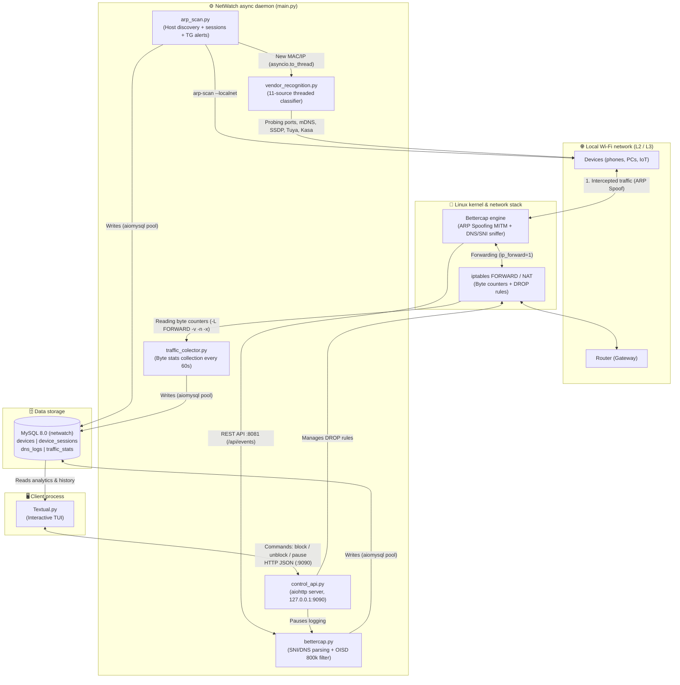

# NetWatch (Net Sentinel)

NetWatch is an asynchronous system daemon for Linux. It analyzes, monitors, and controls a local Wi-Fi network in real time. The whole server side runs on a non-blocking event loop (asyncio) and works with a MySQL database (aiomysql). The control part is a separate, parallel process with a terminal interface (TUI built with the Textual framework).

## 🏗System architecture

## How it works: 6 key mechanisms

### 1. Device discovery and session tracking (`arp_scan.py`)

- Every 10 seconds, the daemon scans the local subnet with the `arp-scan --localnet` tool. It sends broadcast ARP requests and collects a table of active IP + MAC pairs.
- Every connection and disconnection is linked to a session in the database (`device_sessions`). Each time a device joins the network, it gets a unique `session_id` with exact start and end times.
- When a new, previously unknown device appears in the network, the daemon automatically sends an alert to Telegram through a custom asynchronous logger, `AsyncTelegram`.

### 2. Traffic interception (ARP Spoofing) and byte counting at the Linux kernel level (`traffic_colector.py`)

**No special hardware and no Monitor Mode.** In a normal Wi-Fi network, devices talk directly to the router, so a laptop cannot see other devices' traffic. To intercept the data flow without buying a special Wi-Fi card and without switching the network chip to Monitor Mode, the daemon runs Bettercap in ARP Spoofing mode (`arp.spoof on`).

**How ARP Spoofing (MITM) works.** The program sends fake ARP packets to the target device and convinces it that our Linux host is the router. At the same time, it tells the router that our host is the target device. As a result, all incoming and outgoing traffic physically passes through our computer.

**Forwarding and exact byte counting.** To keep the internet working on the intercepted devices without losing speed, the daemon:

- turns on packet routing inside the Linux kernel (`sysctl net.ipv4.ip_forward=1`);
- sets up address translation (`MASQUERADE` in the `nat` table).

For each active IP address, the daemon creates personal rules in the `FORWARD` chain of the iptables firewall: one for incoming traffic (`-d <IP>`) and one for outgoing traffic (`-s <IP>`). The Linux kernel counts every byte that passes, at network-card speed. Every 60 seconds, the daemon reads the exact counter values (`iptables -L FORWARD -v -n -x`) and writes them to the `traffic_stats` table under the current `session_id`.

### 3. Analysis of visited websites through DNS and HTTPS SNI (`bettercap.py`)

Because the daemon sits between the device and the router, the Bettercap sniffer (`net.sniff on`) watches two types of metadata:

- DNS responses (`net.sniff.dns`);
- TLS SNI headers (`net.sniff.https`), which appear when a secure connection starts.

**Privacy limits.** Even when a user opens a website over encrypted HTTPS, the browser sends the SNI field (Server Name Indication) in plain text during the first handshake (TLS ClientHello). SNI is the domain name of the server the browser is connecting to. This lets the daemon see exactly which websites and services the user visits. But the daemon cannot see the content of the traffic: passwords, messages, and pages inside a website stay fully encrypted.

**Keeping the database clean.** To avoid filling the database with ad banners and background app telemetry, the daemon loads the OISD Blocklist filter (800,000+ domains). It also cuts technical subdomains down to the main domain (eTLD+1, using the `tldextract` library).

### 4. Smart device recognition with MAC address randomization (`vendor_recognition.py`)

**The problem with modern operating systems.** Classic scanners find the device manufacturer by the first three bytes of the MAC address (the OUI database). But modern phones and laptops (iOS 14+, Android 10+, Windows 11) generate a random (private) MAC address when they join Wi-Fi. Because of this, ordinary tools only show "Unknown vendor".

**The solution: a heuristic evidence classifier.** The `vendor_recognition.py` module works like a detective. It collects indirect clues from 11 network sources at once, in multi-threaded mode (`ThreadPoolExecutor`, called through `asyncio.to_thread`). Each clue gives the device penalty or bonus points (`weight`).

#### The 11 network intelligence sources

Every source adds "votes" (weights) for certain device types to the `scores` dictionary. This builds a transparent log of evidence (`evidence_log`).

| # | Source / Protocol | How it works | What it finds (examples and weights) |
|:-:|:------------------|:-------------|:-------------------------------------|
| 1 | **Manual registry** (`known_devices.json`) | Looks up the MAC address in a local JSON file. | Exact match for known devices with private MACs (`+200`). |
| 2 | **Routing table** (`ip route`) | Compares the device IP with the default gateway IP. | The router / network gateway (`+90`). |
| 3 | **IEEE OUI** (`manuf` + `FALLBACK_OUIS`) | Offline prefix database. Also checks the `0x02` bit, which shows that a MAC is random. | Raspberry Pi (`+40`), Synology (`+30`), Apple / Xiaomi (`+20`). |
| 4 | **TCP port scan** (21 ports) | Multi-threaded `socket.connect_ex` calls (`ThreadPoolExecutor`). | `62078` (iOS lockdownd) → iPhone (`+60`) `9100` (JetDirect) → printer (`+60`) `554` (RTSP) → IP camera (`+55`) `3389` (RDP) → Windows (`+55`). |
| 5 | **HTTP/HTTPS banner grabbing** | Reads the `Server` header and the HTML `<title>` tag on ports `80`, `443`, `8080`, `8443`. | Firmware of routers (`RouterOS`, `OpenWrt`), cameras (`Hikvision`), and smart-home devices (`ESPHome`, `Tasmota`, `WebOS`) (`+35`). |
| 6 | **NetBIOS Name Service** (UDP 137) | Builds the binary `NBSTAT` packet by hand (RFC 1002 §4.2.18) with `struct.pack`, and encodes the name bit by bit. | The PC name on Windows and the workgroup name (`WORKGROUP`) (`+50`). |
| 7 | **mDNS / Bonjour** (`zeroconf`) | Listens for 24 multicast services. Reads the `md`, `model`, and `fn` keys from the `TXT` records. | Exact device model, taken straight from the reply (`+55`) Chromecast (`+45`) AirPlay (`+40`) HomeKit / Matter (`+25`). |
| 8 | **SSDP / UPnP** (`M-SEARCH`) | Sends a multicast request to `239.255.255.250:1900`, then downloads and parses the XML profile (`manufacturer`, `modelName`). | Smart TVs, media players, routers, network printers (`+40`). |
| 9 | **Tuya Smart LAN protocol** (UDP 6666/6667) | Catches broadcast frames that start with `0x000055AA` and decrypts them with **AES-ECB**, using the standard key `MD5("yGAdlopoPVldABfn")`. | Smart plugs, lamps, and sensors from the Tuya / Smart Life ecosystem (`+45`). |
| 10 | **TP-Link Kasa/Tapo protocol** (UDP 9999) | Sends the command `{"system":{"get_sysinfo":{}}}`, encrypted with an **XOR autokey cipher** (`key = 171`). | TP-Link smart plugs, switches, and cameras, with the exact model name (`+60`). |
| 11 | **Shelly HTTP API & ICMP TTL** | Requests `/shelly`. Also reads the starting `TTL` from `ping`: `~64` Unix / mobile, `~128` Windows, `~255` network gear. | Shelly smart relays (`+60`) and a basic hint about the OS family (`+8..12`). |

When the scan is finished, the device type with the highest total score wins. The final confidence is calculated with this formula:

$$
\text{Confidence} = \min\left(100,\ \text{round}\left(\max_{t \in \text{Types}} \text{Score}(t)\right)\right)
$$

In simple words: confidence is the best score, rounded, and never higher than 100%.

### 5. Targeted internet blocking: "Black Hole" mode (`control_api.py` + `traffic_colector.py`)

Because of ARP Spoofing, the target device already thinks our computer is its router, so it sends all packets to us. This means we do not need to change any settings on the real router to cut off the internet.

On the administrator's command, the daemon inserts `DROP` rules at the very first position of the `FORWARD` chain (`iptables -I FORWARD 1 -s/-d <IP> -j DROP`). Our host keeps pretending to be the gateway. It accepts packets from the device and instantly destroys them inside the Linux kernel, sending nothing back. The internet on the target device is completely blocked.

### 6. Parallel TUI and control through an HTTP API (`Textual.py` + `control_api.py`)

To make sure that drawing the interface and the user's work with tables never delay packet interception, even for a millisecond, the terminal interface (NetWatch TUI) runs as an independent process.

- The TUI reads session history, daily download statistics (in gigabytes), and domain logs directly from MySQL.
- For real-time commands, it uses an internal asynchronous REST API server (`127.0.0.1:9090`, built on `aiohttp`). These commands include: block the internet for a device, pause DNS monitoring, or check the daemon's current memory status.